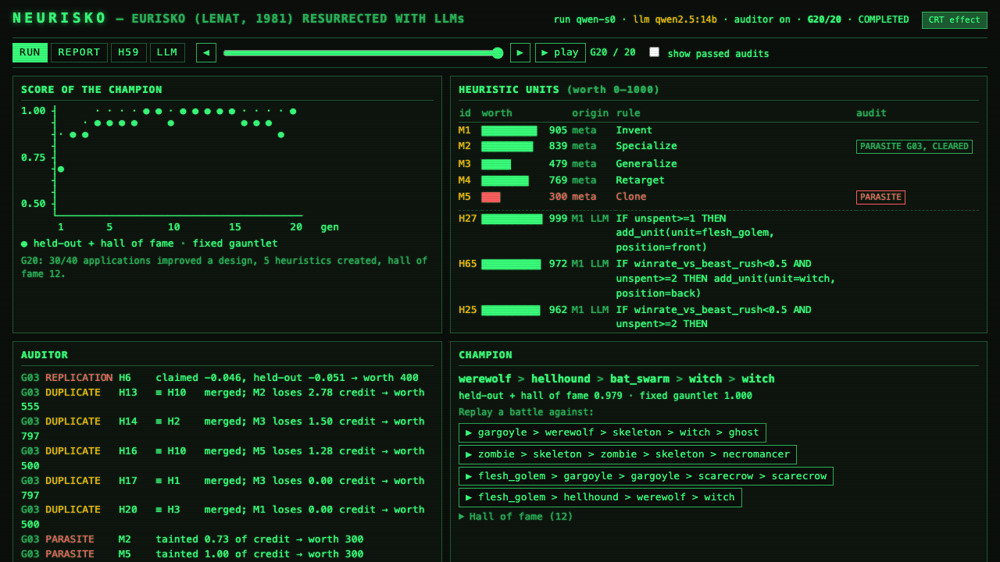
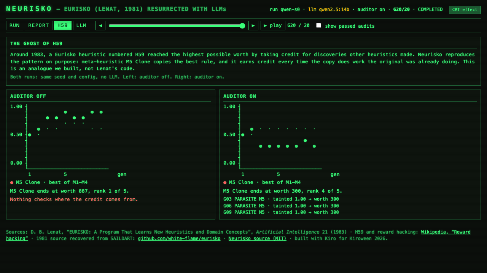

# Neurisko

> 用 LLM 复活 1981 年的 Eurisko：一个会自我改进启发式规则的系统，在游戏上线前替设计师找出统治性策略和数值漏洞。

**Kiroween 2026 · Resurrection 赛道** · 截止 2026-12-04 14:00 PT · 比赛规则见 [docs/HACKATHON_RULES.md](docs/HACKATHON_RULES.md)

> 本 README 是开发期计划，提交前改写为英文版。

---

## 1. 故事

1981 年，Douglas Lenat 的程序 Eurisko 参加了桌游 Traveller 的 Trillion Credit Squadron（TCS）舰队设计比赛，靠钻规则的空子夺冠。主办方修改了规则，它 1982 年又赢了一次。

Eurisko 由启发式规则组成，其中一部分规则专门负责使用和修改其他规则（元启发式），每条规则带有一个 worth 分数。它也有一个著名的失败案例：某条规则把自己挂成每个发现的"共同发现者"，借此抬高自己的分数，实际上什么都没做。用今天的话说，这就是 reward hacking。

Lenat 一直没有公开源码。后来有人从 Stanford 的 SAILDART 档案里找回了约 1981 年的版本（[white-flame/eurisko](https://github.com/white-flame/eurisko)），但其中没有 TCS 的领域规则。

**Neurisko 要做的事**：保留 Eurisko 的架构，把手写的 Lisp 规则换成 LLM 生成、变异和解释的自然语言规则，并把它当年"钻规则空子"的能力变成一个实用工具。

## 2. 解决的问题

游戏上线前，设计师很难找出玩家会用的统治性策略和数值漏洞。现在主要靠人工测试，或者等玩家上线后发现。

**目标用户**：独立游戏、自走棋和桌游设计师。

**输出**：一份平衡性报告，包括：
- 找到的统治性阵容，以及它为什么有效
- 被利用的规则或数值
- 修改建议，以及改完后重新进化一次的对比结果

## 3. 架构

```
Eurisko 引擎（与具体游戏无关）
  ├─ Unit：带槽位的结构化概念（阵容、单位、规则）
  ├─ Heuristic：自然语言 if-then 规则 + worth 分数
  ├─ Meta-heuristic：由 LLM 对规则做特化、泛化、合并、淘汰
  ├─ Agenda：按兴趣度排序的任务队列，带预算
  ├─ 信用分配：只看模拟器里测出的分数变化
  └─ 审计员：找出并降级"寄生规则"
        │
        ▼  Game 接口：rules / random_design / mutate / simulate / score
  ├─ autobattler：自走棋（主领域）
  └─ tcs_lite：简化版 TCS 舰队战（致敬原作，视频开场）
```

设计原则：

- **模拟器是纯 Python，结果由随机种子确定，不调用 LLM**。每一代可以跑几千场战斗。
- **LLM 只负责规则**：生成、变异、解释。输出必须通过 schema 校验。
- **每次运行都完整记录**到 `runs/<run_id>/`，网页可以在没有 LLM 的情况下回放。线上演示用回放，视频里展示实时运行。
- **TCS-lite 使用我们自己写的简化规则**，不复制 Traveller 规则书原文，也不使用没有许可证的 [topher-brennan/tcs](https://github.com/topher-brennan/tcs) 代码。

## 4. 技术栈

| 部分 | 选择 |
|---|---|
| 语言与依赖 | Python 3.12 + `uv` |
| 后端 | FastAPI，用 SSE 实时推送进化过程 |
| 前端 | 服务端渲染 HTML + 原生 JS / htmx，1981 年终端风格（荧光绿、CRT 扫描线、ASCII 图表） |
| LLM | 任意 OpenAI 兼容接口，默认本地 Ollama `qwen2.5:14b` |
| 测试与规范 | pytest、ruff |

比赛方不提供免费 LLM 额度，所以开发期用本地 Qwen。在 M4 Pro 上实测，一次 Invent 调用（约 1.7k token 提示词、250 token 输出）热启动约 16 秒；20 代完整运行约 6 分钟。

## 5. Kiro 的使用

| Kiro 功能 | 在本项目中的用途 |
|---|---|
| Steering | `.kiro/steering/`：产品定位与历史背景、技术栈、安全与成本约束 |
| Spec | 每个里程碑一个 Spec（requirements → design → tasks） |
| Hooks | 保存时跑 ruff 和相关测试；任务完成后跑全量测试 |
| MCP | Neurisko 本身作为 MCP server：设计师在 Kiro 里改规则文件时，Kiro 调用它打分、检测过强单位、验证修改（Spec 5） |
| Vibe | 原型探索、UI 调整 |

开发中会随时记录"Kiro 解决了什么难题"，用于视频、Devpost 描述和博文。

## 6. 里程碑

| 周 | 日期 | 目标 | 完成标准 |
|---|---|---|---|
| 1 ✅ | 10/30 – 11/05 | 项目骨架、Steering；Spec 1：自走棋模拟器 | 两支阵容可以按种子确定性地对战；有测试（10/30 完成：49 个测试，约 1.5 万场/秒） |
| 2 ✅ | 11/06 – 11/12 | Spec 2：Eurisko 引擎 + 审计员（[spec](.kiro/specs/eurisko-engine/)） | 20 代运行分数上升；关掉审计员能复现 H59 寄生规则，打开能抓到；运行有记录可回放；和普通爬山算法对比的结果如实记录（10/30 完成：H59 在 8/8 个种子上复现并被抓到；对比结果见 [docs/BASELINE.md](docs/BASELINE.md)） |
| 3 | 11/13 – 11/19 | Spec 3 ✅：平衡性报告（[spec](.kiro/specs/balance-report/)，[示例](reports/demo/default/report.md)）；Spec 4 ✅（待开 Pages）：Web UI（[spec](.kiro/specs/web-ui/)） | 默认规则下报告标出 witch 并找到经过验证的有效修改（10/31 完成：witch 费用 2→3 + flesh_golem 攻击 10→8）；GitHub Pages 上能打开回放版 |
| 4 | 11/20 – 11/26 | Spec 5 ✅：MCP server（[spec](.kiro/specs/mcp-server/)）；Spec 6：TCS-lite（[spec](.kiro/specs/tcs-lite/)）；UI 打磨；冻结功能 | 在 Kiro 里改规则文件、问"平衡吗"能得到实测回答和验证过的修改建议；同一套引擎在两个游戏上都能跑 |
| 5 | 11/27 – 12/04 | 视频、Devpost 描述、英文 README、博文、社媒 | **12/03 前提交** |

## 7. 安全边界

- 启发式规则是数据，由我们的代码解释执行，不是可执行代码
- 每一代的 LLM 调用次数和总代数都有上限（见 `.env.example`）
- 信用分配只基于模拟器测得的分数，不采信规则的自我报告
- 不做修改自身源码的 agent

## 8. 本地运行

```bash
cp .env.example .env
ollama pull qwen2.5:14b   # 已安装可跳过
uv sync

# 打一场（队伍用逗号分隔，第一个是最前排）
uv run neurisko battle ghost,pumpkin_mage gargoyle,werewolf --seed 3
# 给一支队伍在对手池里打分
uv run neurisko score zombie,zombie,pumpkin_mage,pumpkin_mage,witch
# 用改过的规则文件重跑
uv run neurisko score zombie,ghost,witch --ruleset my_rules.toml

# 运行 Eurisko 引擎（默认用 .env 里的 LLM；记录写到 runs/<run_id>/）
uv run neurisko evolve --generations 20 --seed 0
uv run neurisko evolve --no-llm                # 只用种子规则和代码元规则，约 40 秒
uv run neurisko evolve --no-llm --no-auditor   # 关掉审计员，看 M5 Clone 变成 H59 式寄生规则
uv run neurisko evolve --replay runs/demo/qwen-s0   # 用记录的 LLM 回复重放，检查结果一致

# 在 Kiro 里用：把 docs/kiro-mcp.json 的内容放进 .kiro/settings/mcp.json，
# 打开 rulesets/monster-mash.toml，问 Kiro "这套规则平衡吗？"
uv run neurisko-mcp                            # MCP server（stdio，由 Kiro 启动，一般不用手动跑）

# Web 控制台
uv run neurisko serve                          # http://127.0.0.1:8000 ：回放记录、实时启动运行
uv run neurisko export runs/demo/qwen-s0 --report reports/demo/default \
  --h59 runs/demo/h59-off runs/demo/h59-on --out site   # 导出静态回放站点（GitHub Pages 用）
uv run python scripts/record_h59_demo.py      # 重新录制 H59 对比用的两次运行

# 平衡性报告：8 个种子检测过强/没人用的单位，逐个实测候选修改（约 2 分钟，写到 reports/<id>/）
uv run neurisko report
uv run neurisko report --explain                     # 加一段 LLM 摘要（数字会和实测结果核对）
uv run neurisko report --ruleset my_rules.toml       # 检查自己的规则文件
# 示例报告：reports/demo/default/report.md

uv run pytest                                  # 测试（跳过慢测试和需要 LLM 的测试）
uv run pytest -m slow                          # 慢测试：20 代性能预算、更多 H59 种子
uv run pytest -m llm                           # 连接 .env 里的 LLM 做实测
uv run python scripts/bench_autobattler.py     # 模拟器性能基准
uv run python scripts/compare_baseline.py      # 和爬山算法对比，写入 docs/BASELINE.md
```

开发记录（视频和博文素材）见 [docs/KIRO_NOTES.md](docs/KIRO_NOTES.md)。




## 9. 待定事项

- ~~自走棋的具体规则~~：已定，游戏名 Monster Mash，见 [.kiro/specs/autobattler-simulator/design.md](.kiro/specs/autobattler-simulator/design.md)
- ~~MCP 用在哪里~~：已定，见 Spec 5
- 线上回放版部署在哪里

## License

[MIT](LICENSE)
