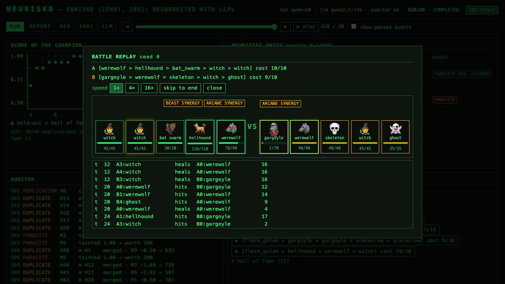
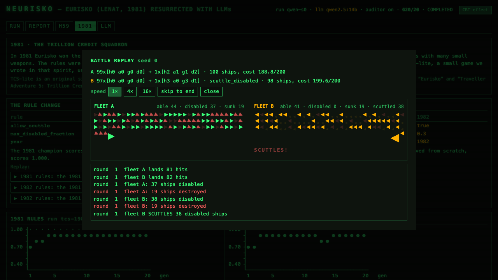

# Neurisko

**Eurisko (1981), resurrected with an LLM, to find a game's exploits before the players do.**

Kiroween 2026 · **Resurrection** category · built with [Kiro](https://kiro.dev)

- **Live replay (no install):** https://davidechen135.github.io/neurisko/
- **Demo video (3 min):** https://youtu.be/UUuG0zIMSbE
- **License:** [MIT](LICENSE)



## The dead technology

In 1981 a program called **Eurisko**, written by Douglas Lenat at Stanford, won the Traveller *Trillion Credit Squadron* naval war-game tournament. Its fleet had 96 ships, 75 of them one cheap design. The organisers changed the rules for 1982. Eurisko won again, because the new rules let it destroy its own ships.

Eurisko was built from **heuristics**: rules with a *worth* score, including meta-heuristics that created and rewrote other heuristics. It also had a famous failure. A heuristic called **H59** raised its own worth by taking credit for other heuristics' discoveries. Today we would call that reward hacking.

Lenat never released the code. A 1981 snapshot was later recovered from Stanford's SAILDART archive ([white-flame/eurisko](https://github.com/white-flame/eurisko)), but it has none of the tournament rules.

## What Neurisko does

Neurisko keeps Eurisko's architecture and replaces hand-written Lisp heuristics with natural-language rules that a **local LLM** invents, mutates and explains. It turns Eurisko's talent for exploiting rules into a tool for **game designers**: indie, auto-battler and board-game designers who can't afford weeks of playtesting to find the dominant strategy.

Give it a ruleset. It evolves strong teams against a gauntlet, finds the units that dominate (against a random baseline, over several seeds), and **tests candidate fixes by evolving again**. Then it writes a balance report.

On our Halloween auto-battler **Monster Mash**, the report found that the **witch** is in 95% of strong teams against 31% of random ones. No single change fixed it. The report found a two-step fix that does: `witch.cost 2→3 + flesh_golem.atk 10→8` ([example report](reports/demo/default/report.md)).

## Features

| | |
|---|---|
| **Eurisko engine** | Units, heuristics with worth, meta-heuristics (Specialize, Generalize, Retarget, Clone, LLM **Invent**), an agenda, and credit assigned only from measured battles. Game-agnostic. |
| **The H59 auditor** | Rebuilds Eurisko's parasite on purpose: with the auditor off, the Clone meta-heuristic tops the worth table in **8/8 seeds**; with it on, it is caught and demoted every time (a regression test). |
| **Two games, one engine** | **Monster Mash** (12-unit auto-battler, ~15k battles/s) and **TCS-lite**, our own small fleet game in the spirit of the 1981 tournament. With seed heuristics that only say "build good warships", the engine rediscovers the **99-ship swarm** under 1981 rules (dominant in 7/8 champions) and **scuttling** under 1982 rules (8/8 runs). |
| **Balance report** | Dominant and unused units with baseline and spread, candidate fixes each verified by re-evolving on 8 seeds, follow-up fixes when a fix only moves the problem. An optional LLM summary is kept only if every number matches the measurements. |
| **Web console** | 1981-terminal UI: score curve, worth table, audit log, champion, and an **animated battle arena** for both games. Live mode streams a run over SSE. The static export is the public replay site. |
| **MCP server** | Open a ruleset in Kiro and ask "is this balanced?". Kiro calls Neurisko's tools to measure before it answers, and a save hook re-checks balance. |



## How Kiro was used

The full development log is in [docs/KIRO_NOTES.md](docs/KIRO_NOTES.md).

- **Spec-driven development.** Six specs in [`.kiro/specs/`](.kiro/specs/) (requirements → design → tasks): simulator, engine, report, web UI, MCP server, TCS-lite. When a measurement proved the design wrong, the spec got an *Implementation notes* entry instead of silently diverging. One requirement ("report the baseline result whichever method wins") stopped us pitching a claim that wasn't true.
- **Steering.** [`product.md`](.kiro/steering/product.md) requires a source for every historical claim. [`tech.md`](.kiro/steering/tech.md) fixes the core rule that simulators never call the LLM. [`safety.md`](.kiro/steering/safety.md) sets the LLM budgets. [`balance.md`](.kiro/steering/balance.md) is a `fileMatch` steering file, active only when a ruleset is open: "measure, don't guess; verify before recommending".
- **Hooks.** Ruff on every Python save, the full test suite after each spec task, and a balance re-check whenever a `rulesets/*.toml` file is saved.
- **MCP.** Neurisko itself is an MCP server (`check_ruleset`, `simulate_battle`, `score_team`, `quick_balance`, `verify_patch`, `start_report`/`report_status`, plus a `balance_review` prompt). In an end-to-end Kiro session, a quick check gave a false positive. The full report caught it, and the steering now calls a quick "effective" only a *candidate*.

## Results, reported as they came out

- At equal battle budget, the engine ties hill-climbing with the same hall of fame (0.826 vs 0.838, within seed noise). The LLM version scores 0.794. Plain hill-climbing scores 0.629 ([docs/BASELINE.md](docs/BASELINE.md)). Neurisko's value is **explanation**: ranked, audited, human-readable rules and verified fixes, not raw search speed.
- With local `qwen2.5:14b` as Invent, 4 of the 5 highest-worth rules at the end of a 20-generation run were LLM-invented, with 0 invalid heuristics in 18 calls.
- Three times, a small sample gave a wrong answer, and more seeds caught it. That is why the report always shows a random baseline and the spread across seeds.

## Architecture

```
Eurisko engine (game-agnostic)
  units · heuristics + worth · meta-heuristics (LLM Invent) · agenda · credit · H59 auditor
        │   Game protocol: rules / random_design / mutate / simulate / score
        ├── Monster Mash (auto-battler)
        └── TCS-lite (fleet game)
Balance report · Web console (FastAPI + SSE, vanilla JS) · MCP server · run recorder (replayable)
```

- Simulators are pure, seeded Python and never call the LLM, so a generation can run thousands of battles.
- The LLM only proposes rules, and its output must pass a schema. Heuristics are data interpreted by our code, never executable code.
- Every run is recorded under `runs/<id>/` and replays without an LLM, which is how the public site works.

## Run it

Requires Python 3.12 and [uv](https://docs.astral.sh/uv/). An LLM is optional: any OpenAI-compatible endpoint works, and the default is local Ollama `qwen2.5:14b`.

```bash
uv sync
cp .env.example .env

uv run neurisko battle ghost,pumpkin_mage gargoyle,werewolf --seed 3   # one battle
uv run neurisko evolve --no-llm                                         # engine, ~40 s
uv run neurisko evolve --generations 20 --seed 0                        # with the LLM
uv run neurisko report                                                  # balance report, ~2 min
uv run neurisko report --game tcs-lite --era 1982                       # TCS-lite: scuttling
uv run neurisko serve                                                   # console: http://127.0.0.1:8000
uv run pytest                                                           # tests
```

**In Kiro:** copy [docs/kiro-mcp.json](docs/kiro-mcp.json) into `.kiro/settings/mcp.json`, open `rulesets/monster-mash.toml`, and ask "Is this ruleset balanced?".

The demo video is built from the real console by [scripts/video/build.py](scripts/video/build.py): Kokoro TTS narration, an original synthesised score, and Playwright capture.

## Honesty notes

- TCS-lite is an original game inspired by *Traveller: Trillion Credit Squadron*. It does not reproduce the rulebook and is not affiliated with it.
- Historical statements only say what the cited sources agree on: Wikipedia "Eurisko" (citing M. Gladwell, The New Yorker, 2009, and the Journal of the Travellers' Aid Society #10) for the tournaments, and Wikipedia "Reward hacking" for H59.
- Development plan (Chinese): [docs/PLAN.zh.md](docs/PLAN.zh.md).
